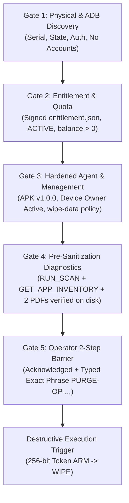

# CYVRA MOBILE — CONTROLLED 50-DEVICE ROLLOUT PLAN

**Document ID:** `CYVRA-ROLLOUT-50DEV-V1`  
**Date:** 2026-10-26  
**Authority:** Approved Controlled 50-Device Rollout Plan Directive from Chief Engineer  
**Baseline Commit:** `73eee4f880ad5e64562d9bb7f0fcff5a02f3d8e1` (`main`)  
**Status:** **GOVERNED PLANNING SPECIFICATION — DESTRUCTIVE EXECUTION PROHIBITED**

---

## 1. Operating Principle & Scope

A single successful physical factory reset on device `R9BN3015NQJ` (Samsung Galaxy A10s, Android 11, API 30) proves the viability of the hardened two-phase `ARM` $\rightarrow$ `WIPE` Device Owner protocol on that specific hardware, OEM build, and OS version.

It **does not establish universal compatibility** across different Android releases (Android 8 through 15), diverse OEM frameworks (Samsung Knox, Xiaomi MIUI/HyperOS, Motorola/Lenovo, Google Pixel, Transsion), varying USB controller behaviors, or multi-device USB hub topologies.

Therefore, fleet deployment across up to 50 device slots is structured as a **strictly gated, sequential, evidence-verified rollout**. Under no circumstances will batch destructive wipes be executed simultaneously or without individual operator authorization per device.

---

## 2. Per-Device Inventory & Identity Architecture

Each physical device connected to the CYVRA Mobile workstation must have an isolated, non-fungible `DeviceTransactionRecord`.

### 2.1 Device Identification Invariants
1. **No Hardware Position Heuristics:** USB physical port numbers, bus topology index, or UI list position must never serve as device identity.
2. **Immutable Primary Identity:** The unique hardware serial number (ADB serial validated against PnP instance ID) serves as the persistent hardware key.
3. **Cryptographic Transaction Isolation:**
   - Every scan transaction receives a globally unique `sessionUuid` (UUIDv4).
   - Every device receives an immutable `deviceLifecycleId` (`UUIDv5(NAMESPACE_DNS, "cyvra.device." + serial)`).
   - Every purge operation receives a unique `operationId` (`PURGE-OP-<hex8>`).
   - Every purge trigger uses a single-use 256-bit `wipeToken` (`SecureRandom`, 32 bytes hex-encoded, 60-second TTL).
4. **Zero Cross-Device Contamination:** Tokens, scan evidence, inventory manifests, confirmation phrases, and PDF reports generated for Device A are mathematically and cryptographically rejected if presented to Device B.

### 2.2 Per-Device Data Schema
```yaml
DeviceTransactionRecord:
  hardwareSerial: string          # e.g., "R9BN3015NQJ"
  deviceLifecycleId: string       # e.g., "26d7d7ee-c33d-340f-99f8-8a4c9d63d1f2"
  oemManufacturer: string         # e.g., "samsung"
  modelName: string               # e.g., "SM-A107F"
  androidVersion: string          # e.g., "11"
  apiLevel: int                   # e.g., 30
  buildFingerprint: string        # e.g., "samsung/a10sxx/..."
  deviceRole: enum                # [TEST_UNIT, PRODUCTION_UNIT, QUARANTINED]
  adbTransportId: int             # e.g., 1 (pre-reset) -> 2 (post-reset)
  activeSessionUuid: string?      # e.g., "2db1cb43-334a-415c-84ad-415a5ec322fa"
  scanCompleted: bool
  hwScanPdfSha256: string?
  appScanPdfSha256: string?
  sanitizationOperationId: string?
  sanitizationAuthorized: bool
  wipeTokenGenerated: bool
  wipeTriggerOutcome: enum        # [NOT_ISSUED, DELIVERED, INDETERMINATE, BLOCKED]
  postResetObserved: bool
  postResetBootReason: string?    # e.g., "reboot,factory_reset"
  finalAuditPdfSha256: string?
```

---

## 3. Independent Pre-Flight & Readiness Gates

Before any device can advance through the workflow, it must independently clear five mandatory gates:



### Gate 1: Physical & ADB Discovery
- ADB state must strictly be `device` (never `unauthorized`, `offline`, or `recovery`).
- No Google/Samsung/OEM user accounts present (`dumpsys account` must report 0 accounts; otherwise provisioning fails).
- USB debugging persistent across re-enumeration.

### Gate 2: Entitlement & Quota
- Workstation holds valid `C:\ProgramData\CYVRA Mobile\entitlement.json`.
- Status is `ACTIVE` and `validUntil` > current timestamp.
- Available quota: `scansRemaining >= 1`.
- Concurrency limiter: Host validates slot reservation before initiating operations.

### Gate 3: Agent Provisioning & Key Provenance
- Release APK installed: `com.cyvra.sanitization` v1.0.0 (`FB30F3F7D8800817B50142D1B19CBD3263B6A070D560E4B596D0A946385994FD`).
- Device Owner successfully provisioned: `dpm set-device-owner com.cyvra.sanitization/.SanitizationAdmin`.
- Verified `testOnlyAdmin = false` and active policy `wipe-data`.
- Signing key: Verified against expected test or production certificate.

### Gate 4: Pre-Sanitization Reports
- Hardware Scan (`RUN_SCAN`) successfully completed.
- Application Scan (`GET_APPLICATION_INVENTORY`) successfully completed.
- Both PDF artifacts generated directly to `Downloads/CYVRA/` and verified for non-zero size, `%PDF-1.4` header, and matching SHA-256 hash.

### Gate 5: Two-Step Operator Barrier
- Step 1: Explicit operator checkbox acknowledgement (`acknowledged: true`).
- Step 2: Explicit operator text input matching the unique dynamic challenge phrase:
  `CONFIRM PURGE <operationId>`.

---

## 4. Staged 50-Device Rollout Phases

```text
+-----------------------------------------------------------------------------------+
| Stage 1: Initial Hardware Baseline (Device 1: R9BN3015NQJ)                       |
|   - COMPLETE: Technical corrections, full physical reset, post-reset forensics.  |
+-----------------------------------------------------------------------------------+
                                         |
                                         v
+-----------------------------------------------------------------------------------+
| Stage 2: Second Device Non-Destructive Compatibility (Device 2)                   |
|   - Connect Device 2 (different model/OEM if available).                          |
|   - Execute non-destructive Gates 1-4 (Discovery, Entitlement, Scans, Reports).   |
|   - Test unarmed and mismatched-token ARM broadcasts in logcat.                   |
|   - STOP BEFORE WIPE: Review logs and report to Chief Engineer.                   |
+-----------------------------------------------------------------------------------+
                                         |
                                         v
+-----------------------------------------------------------------------------------+
| Stage 3: Controlled Second Device Physical Purge (Device 2)                       |
|   - Obtain explicit Chief Engineer authorization for Device 2 serial.             |
|   - Execute single-device wipe and capture post-reset boot reason and PDFs.       |
|   - Review OEM-specific recovery and setup behavior.                              |
+-----------------------------------------------------------------------------------+
                                         |
                                         v
+-----------------------------------------------------------------------------------+
| Stage 4: Limited Multi-Device Pilot (Devices 3 to 10)                             |
|   - Batch size: 3-5 devices simultaneously connected to workstation USB hub.      |
|   - Verify Host concurrency locking (maxConcurrentScans) and serial queueing.     |
|   - Ensure zero session crosstalk or duplicate billing debit.                     |
|   - Document any multi-device USB power/bandwidth dropouts.                       |
+-----------------------------------------------------------------------------------+
                                         |
                                         v
+-----------------------------------------------------------------------------------+
| Stage 5: Full Fleet Operations (Devices 11 to 50)                                 |
|   - Full commercial workstation operations up to licensed quota.                  |
|   - Automated ledger logging (ledger.jsonl) and cryptographic certificate sealing.|
+-----------------------------------------------------------------------------------+
```

---

## 5. Stop Conditions & Safety Interlocks

The workflow must **immediately halt execution on that device** and fail closed under any of the following conditions:

| Trigger Condition | Failure Classification | Mandatory Action |
| :--- | :--- | :--- |
| **Serial Discrepancy** | `TARGET_MISMATCH` | Halt. Invalidate active session. Never issue commands. |
| **Active Accounts on Device** | `PROVISIONING_BLOCKED` | Do not attempt wipe. Instruct operator to manually remove accounts or run clean script. |
| **Device Owner Refused** | `DPM_PROVISIONING_FAILED` | Halt. Device cannot be sanitized via Device Owner path. Refuse fallback to unverified methods. |
| **Token Mismatch / Replay** | `TOKEN_MISMATCH` | Agent immediately disarms. Host marks session failed. Requires full re-scan. |
| **Token TTL Expiry (>60s)** | `TOKEN_EXPIRED` | Agent immediately disarms. Host aborts execution. Requires re-authorization. |
| **Missing Scan Report PDF** | `PRE_REPORTS_MISSING` | Refuse `SANITIZE_START`. Requires regenerating and verifying scan PDFs on disk. |
| **Entitlement Exhausted** | `QUOTA_EXHAUSTED` | Host refuses `RUN_SCAN` and `SANITIZE_AUTHORIZE`. No debit applied. |
| **Unsigned / Tampered APK** | `SIGNATURE_UNVERIFIED` | Installation rejected by ADB or agent refuses start. Halt immediately. |
| **Multi-Device USB Glitch** | `TRANSPORT_ERROR` | Halt affected device queue only. Other device queues remain isolated. |

---

## 6. Failure Recovery & Post-Reset Handling Protocol

1. **Indeterminate Trigger Exit (Exit 224):**
   - When `wipe.trigger()` exits with code 224, it indicates the device disconnected during broadcast dispatch.
   - **Do NOT re-issue WIPE.** Re-issuing to a device that is already rebooting can cause corrupt state or target the wrong device if ports shift.
   - Transition device state to `WAITING_FOR_REBOOT`.
   - Poll ADB for up to 300 seconds for device reconnection.
2. **Re-enumeration Inspection:**
   - Once device reconnects, query:
     - `ro.boot.bootreason`: Must equal `reboot,factory_reset` (or OEM equivalent).
     - `pm list packages com.cyvra.sanitization`: Must be empty.
     - `dumpsys device_policy`: Must be empty.
   - If `ro.boot.bootreason` does NOT indicate factory reset, mark lifecycle as `FAILED_VERIFICATION`, preserve logs, and do not issue certificate.
3. **Physical Screen Verification:**
   - Visual inspection of the physical screen by the operator to verify that the device is at the initial language / "Start" screen.
